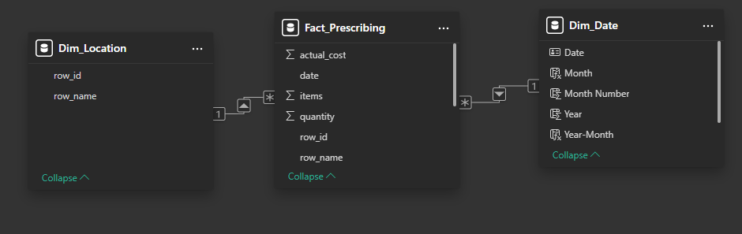
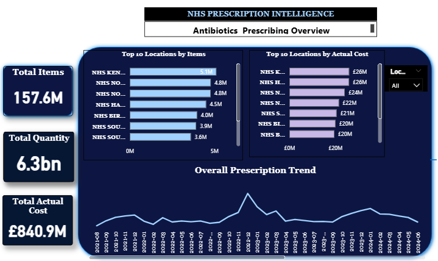
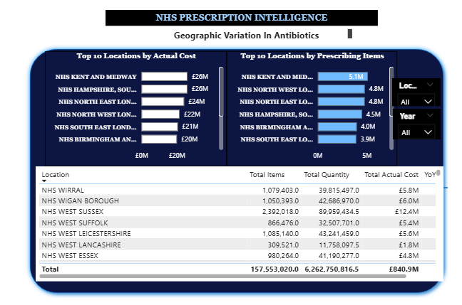
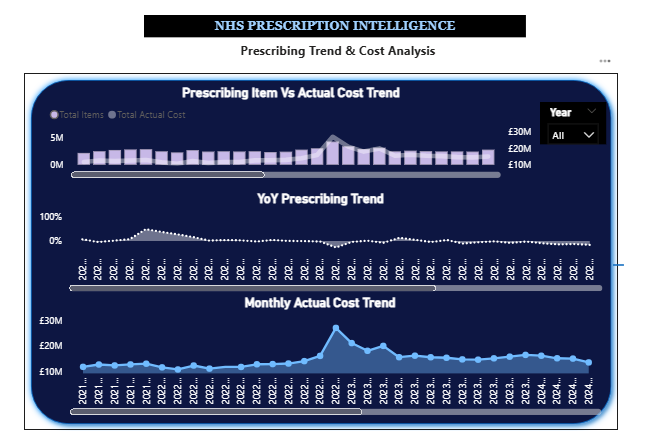

# NHS Prescribing Intelligence
## Exploring Geographic and Temporal Variation in Antibiotic Prescribing Using Power BI


---

# Introduction

Antibiotic prescribing is an important area of medicines optimisation and
antimicrobial stewardship within the NHS.

In this project, I analysed publicly available NHS prescribing data to understand
how recorded antibiotic prescribing activity varies across locations and over time.

Rather than simply creating a dashboard, I wanted the analysis to answer a practical
stakeholder question:

> **How does antibiotic prescribing vary across English primary care locations and
> over time, and which locations or periods show patterns that may warrant further
> investigation?**

An important consideration throughout the project was that **high prescribing
volume does not automatically mean inappropriate prescribing**.

Differences between locations may reflect factors such as population size, age
structure, disease burden, deprivation, seasonal infection patterns, case mix and
service configuration.

I therefore treated the dashboard as a tool for identifying patterns that warrant
further investigation rather than as a tool for labelling locations as good or
poor performers.

---

# Stakeholders

The dashboard was designed primarily for:

- NHS medicines optimisation teams
- Antimicrobial stewardship teams

It could also support:

- Integrated Care Board analysts
- Primary care teams
- Public health analysts
- NHS commissioners

---

# Business Questions

Before starting the analysis, I translated the overall problem into five questions:

1. How much antibiotic prescribing activity is recorded?
2. How has prescribing changed over time?
3. How does prescribing vary between locations?
4. How much does prescribing cost and how has expenditure changed?
5. Which locations or periods show patterns that may warrant further investigation?

These questions guided the data preparation, modelling, DAX measures and dashboard
design.

---

# My Analysis Process

I approached the project through the following stages:

1. Understand the business problem
2. Explore the dataset
3. Validate data quality
4. Prepare the data using Power Query
5. Build a star-schema data model
6. Create DAX measures
7. Analyse overall prescribing activity
8. Investigate geographic variation
9. Investigate prescribing and cost trends
10. Build an interactive Power BI dashboard
11. Translate the findings into stakeholder recommendations

---

# Understanding the Data

Before creating any visualisations, I first examined the structure of the dataset.

The dataset contained:

- **6,420 records**
- **107 locations**
- **60 monthly reporting periods**

The available fields were:

| Field | Description |
|---|---|
| `row_id` | Location/organisation identifier |
| `row_name` | Location name |
| `date` | Monthly reporting period |
| `items` | Number of prescribing items |
| `quantity` | Quantity prescribed |
| `actual_cost` | Actual prescribing cost |

## Understanding the Grain

One of the first questions I asked was:

> **What does one row in this dataset represent?**

There were 107 locations and 60 reporting periods.

Therefore:

**107 locations × 60 months = 6,420 observations**

This matched the number of records in the dataset and confirmed that the analytical
grain was:

> **One location × one month**

Understanding the grain was important because it determined how the data should be
modelled and how measures should be interpreted.

---

# Data Quality Check

Before analysing the data, I checked whether the dataset was suitable for use.

Using Power Query's data-profiling tools, I examined:

- Missing values
- Errors
- Column data types
- Distinct location identifiers
- Distinct location names
- Reporting dates
- Numeric fields

The six fields were **100% valid**, with no errors or empty values identified.

The data therefore required very little cleaning.

Rather than creating unnecessary transformations simply to demonstrate Power Query,
I kept the preparation process minimal.

The main steps were:

1. Imported the prescribing dataset
2. Promoted the first row to column headers
3. Assigned appropriate data types
4. Validated the resulting dataset

The prepared table was then loaded into Power BI as:

`Fact_Prescribing`

---

# Building the Data Model

Once I was satisfied with the quality of the data, I considered how the dataset
should be structured for analysis.

Rather than performing all analysis directly from a single flat table, I created
a simple **star schema**.

The model contains three tables:

### Fact_Prescribing

The central fact table containing:

- prescribing items
- quantity
- actual cost
- date
- location identifier
- location name

### Dim_Location

A location dimension containing the unique:

- location identifier
- location name

This provides a consistent dimension for filtering and comparing locations.

### Dim_Date

Because time was central to the analysis, I created a dedicated Date dimension
containing:

- Date
- Year
- Month
- Month Number
- Year-Month

The resulting model was:

```text
                 Dim_Date
                    |
                    |
                    v
              Fact_Prescribing
                    ^
                    |
                    |
               Dim_Location
```

The relationships were:

- `Dim_Date[Date]` → `Fact_Prescribing[date]`
- `Dim_Location[row_id]` → `Fact_Prescribing[row_id]`

Both relationships were **one-to-many**, with filtering flowing from the dimension
tables into the fact table.



## Why I Used a Star Schema

The star schema gave the report a clear separation between:

- measurable prescribing activity
- location attributes
- time attributes

It also allowed the same Date and Location dimensions to consistently filter
multiple measures and visualisations.

The Date dimension was particularly important because I wanted to analyse changes
over time rather than only reporting totals.

---

# Creating the Measures

With the model in place, I created a small set of DAX measures based directly on
the business questions.

## Total Prescribing Items

```DAX
Total Items =
SUM(Fact_Prescribing[items])
```

This measures the total number of prescribing items within the current filter
context.

## Total Quantity

```DAX
Total Quantity =
SUM(Fact_Prescribing[quantity])
```

This measures the total quantity prescribed.

## Total Actual Cost

```DAX
Total Actual Cost =
SUM(Fact_Prescribing[actual_cost])
```

This measures recorded actual prescribing expenditure.

---

# Adding Time Intelligence

I also wanted to understand whether prescribing was increasing or decreasing
compared with the equivalent period in the previous year.

I created:

```DAX
Previous Year Items =
CALCULATE(
    [Total Items],
    SAMEPERIODLASTYEAR(Dim_Date[Date])
)
```

I then calculated the percentage change:

```DAX
YoY Items % =
DIVIDE(
    [Total Items] - [Previous Year Items],
    [Previous Year Items]
)
```

The year-on-year measure is most meaningful when evaluated within a defined time
context such as a month or year.

For this reason, I used it primarily in the trend analysis rather than presenting
an unfiltered whole-dataset YoY percentage as a headline KPI.

---

# Moving From Measures to Analysis

At this stage, the data had been validated, the model was in place and the core
measures were ready.

The next step was no longer about building Power BI components.

It was about using them to answer the original business questions.

---

# 1. Executive Overview — What Is Happening?

I started with the overall scale of prescribing activity.

Across the complete dataset, the dashboard recorded approximately:

- **157.6 million prescribing items**
- **6.3 billion units of quantity**
- **£840.9 million in actual cost**

These figures establish the overall scale of activity represented in the dataset.

However, these are **absolute totals**, not population-adjusted prescribing rates.

They should therefore be interpreted as measures of recorded activity rather than
measures of prescribing appropriateness.

## Executive Overview Dashboard



The Executive Overview combines:

- Total prescribing items
- Total quantity
- Total actual cost
- Highest-volume locations
- Highest-cost locations
- Overall prescribing trend
- Interactive location filtering

This page was designed to allow a stakeholder to understand the overall picture
before investigating individual locations or time periods.

---

# 2. Geographic Variation — Where Is Prescribing Highest?

After understanding overall activity, my next question was:

> **Is prescribing activity distributed evenly across locations?**

I ranked locations using both:

- Total prescribing items
- Total actual cost

The analysis showed clear geographic variation.

**NHS Kent and Medway** recorded approximately **5.1 million prescribing items**,
the highest item volume visible in the dashboard, and was also among the locations
with the highest recorded actual cost at approximately **£26 million**.

Several other locations also appeared among the highest-volume or highest-cost
areas.

However, an important analytical distinction is necessary.

## High Volume Does Not Mean Overprescribing

The dashboard compares **absolute prescribing totals**.

A location serving a larger population would naturally be expected to record more
prescribing activity than a smaller location.

Differences could also be influenced by:

- Population size
- Population age structure
- Disease burden
- Deprivation
- Seasonal infection patterns
- Case mix
- Local service configuration

I therefore interpreted the highest-volume and highest-cost locations as:

> **Areas for further investigation, rather than evidence of inappropriate
> prescribing.**

## Geographic Variation Dashboard



The page allows stakeholders to:

- Compare the Top 10 locations by prescribing items
- Compare the Top 10 locations by actual cost
- Review exact location-level values
- Filter the analysis by location
- Filter the analysis by year

---

# 3. Trends and Cost — When Did Prescribing Change?

The next question was whether prescribing activity remained stable throughout the
observation period.

When I plotted monthly prescribing activity and actual cost, one period immediately
stood out.

There was a **pronounced increase around late 2022**, with prescribing items and
actual cost increasing during approximately the same period.

Monthly actual cost, which was substantially lower during many other periods,
rose to roughly **£25 million** around the peak.

Because both activity and expenditure increased around the same time, the pattern
warranted further investigation.

## Trends & Cost Dashboard



This page contains three complementary analyses:

### Prescribing Items vs Actual Cost

This allows the stakeholder to examine whether prescribing activity and expenditure
move together over time.

### Monthly Actual Cost

This isolates the expenditure trend and makes unusual cost periods easier to
identify.

### Year-on-Year Prescribing Change

This compares prescribing activity with the equivalent period in the previous year
and helps distinguish sustained changes from isolated monthly movements.

---

# Investigating the Late-2022 Increase

The dashboard shows **what happened**, but the available dataset does not establish
**why it happened**.

Possible explanations that could be investigated include:

- Seasonal infection patterns
- Unusual changes in demand
- Changes in prescribing behaviour
- Changes in service utilisation
- Data or reporting changes
- Changes in the mix or cost of prescribed medicines

These are hypotheses for further investigation rather than conclusions from the
current dataset.

This distinction is important because descriptive analytics can identify unusual
patterns, but additional clinical, demographic and operational information may be
required to explain them.

---

# Key Findings

The analysis produced four main findings.

### 1. Substantial prescribing activity was recorded

Across the dataset there were approximately:

- **157.6M prescribing items**
- **6.3bn quantity**
- **£840.9M actual cost**

### 2. Prescribing activity varies geographically

There was clear variation in absolute prescribing activity and expenditure between
locations.

Kent and Medway recorded the highest prescribing item volume in the dashboard at
approximately **5.1M items** and was also among the highest-cost locations.

### 3. Prescribing and expenditure changed over time

Activity did not remain constant throughout the observation period.

A pronounced increase was visible around **late 2022**.

### 4. Prescribing activity and cost increased together during the main spike

The combined time-series analysis showed an increase in both prescribing items and
actual expenditure around the same period.

This makes the period particularly useful for further investigation.

---

# Recommendations

## 1. Investigate High-Volume and High-Cost Locations

Locations appearing consistently among the highest for prescribing items and cost
could be prioritised for deeper analysis.

However, they should **not** be labelled as overprescribing based on absolute totals.

The next stage should introduce appropriate denominators and case-mix information.

---

## 2. Investigate the Late-2022 Increase

The pronounced increase in prescribing activity and expenditure around late 2022
should be investigated further.

Additional analysis could examine:

- seasonal infection activity
- local demand
- prescribing behaviour
- service utilisation
- reporting changes

This would help determine whether the increase reflects expected seasonal variation
or another underlying factor.

---

## 3. Monitor Trends Rather Than Isolated Months

Stakeholders should consider monthly trends, year-on-year change and expenditure
together rather than reacting to a single high month.

A location or period should therefore be investigated within its broader historical
context.

---

## 4. Introduce Population-Adjusted Measures

A major improvement would be to incorporate registered population data and calculate
measures such as:

> **Prescribing items per 1,000 registered patients**

This would provide a more meaningful basis for geographic comparison.

Further adjustment for age, deprivation, morbidity and other case-mix factors could
strengthen the analysis.

---

# Limitations

This project has several important limitations.

### No population denominator

The dataset contains prescribing totals but does not contain the population served
by each location.

It is therefore not appropriate to interpret differences as prescribing rates.

### No patient-level information

The analysis cannot determine which patients received prescriptions or adjust for
individual clinical characteristics.

### No detailed case-mix adjustment

Differences in population age, disease burden, deprivation and other factors may
partly explain geographic variation.

### Descriptive rather than causal analysis

The dashboard identifies patterns and associations.

It does not establish why a particular location has higher prescribing activity or
why a particular period experienced an increase.

### No medicine-level field in the analytical extract

The available dataset did not contain a drug field suitable for comparing individual
antibiotics or antibiotic classes.

The analysis therefore focuses on overall antibiotic prescribing activity,
quantity and cost.

---

# Future Improvements

The next version of the project could incorporate:

- Registered population denominators
- Prescribing items per 1,000 patients
- Age-standardised or case-mix-adjusted comparisons
- Deprivation measures
- More detailed medicine-level information
- Antibiotic class analysis
- Seasonal benchmarking
- Statistical detection of unusual variation
- Additional NHS organisational/contextual data

These additions would allow the dashboard to move from describing absolute activity
towards more meaningful comparative prescribing intelligence.

---

# Dashboard Design

The final Power BI report contains three pages.

### Page 1 — Executive Overview

Answers:

> **What is happening overall?**

Includes headline KPIs, geographic leaders and the overall prescribing trend.

### Page 2 — Geographic Variation

Answers:

> **Where does prescribing activity and expenditure vary?**

Includes Top 10 comparisons, location-level detail and interactive Location and
Year filtering.

### Page 3 — Trends & Cost

Answers:

> **When did prescribing and expenditure change?**

Includes cost trends, year-on-year change and comparison of prescribing items with
actual cost.

---

# Skills Demonstrated

This project demonstrates practical experience in:

### Power BI

- Interactive dashboard development
- KPI design
- Business-focused visualisation
- Slicers and visual interactions
- Report-page design

### Power Query

- Data inspection
- Data type validation
- Data-quality profiling
- Reproducible data preparation

### Data Modelling

- Fact and dimension tables
- Star-schema modelling
- One-to-many relationships
- Date dimensions
- Filter propagation

### DAX

- `SUM`
- `CALCULATE`
- `DIVIDE`
- `SAMEPERIODLASTYEAR`
- Filter context
- Time intelligence

### Data Analysis

- Business-question definition
- Geographic comparison
- Trend analysis
- Year-on-year analysis
- Cost analysis
- Identification of unusual patterns
- Responsible interpretation of descriptive statistics

### Healthcare Analytics

- NHS stakeholder framing
- Medicines optimisation
- Antimicrobial stewardship context
- Understanding the importance of denominators
- Recognition of case-mix and population differences
- Avoiding inappropriate conclusions from raw healthcare activity data

---

# Conclusion

This project demonstrates how Power BI can be used to transform prescribing data
into practical healthcare intelligence.

The analysis identified substantial geographic and temporal variation in recorded
antibiotic prescribing across English primary care locations.

Approximately **157.6 million prescribing items**, **6.3 billion units of quantity**
and **£840.9 million in actual cost** were represented in the dataset.

Kent and Medway recorded the highest item volume in the dashboard at approximately
**5.1 million items** and was also among the highest-cost locations.

A pronounced increase in both prescribing activity and expenditure was also observed
around late 2022.

These findings highlight locations and periods that may warrant further investigation,
but they should not be interpreted as evidence of inappropriate prescribing without
population denominators and appropriate case-mix adjustment.

For NHS stakeholders, the dashboard therefore serves as a **decision-support and
investigation tool**: it helps identify **where and when to look more closely**,
rather than making unsupported judgements about prescribing quality.

---

# Repository Structure

```text
NHS-Prescribing-Intelligence/
│
├── README.md
│
├── dashboard/
│   └── NHS_Prescribing_Intelligence.pbix
│
├── images/
│   ├── executive_overview.png
│   ├── geographic_variation.png
│   ├── trends_cost.png
│   └── data_model.png
│
└── data/
```

---

## Author

**Ransom Chukwu**

